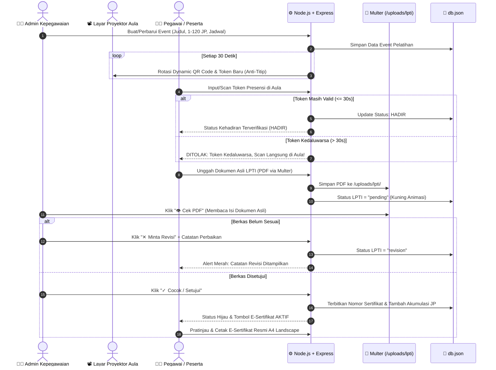

# 🏛️ Sistem Presensi Mandiri, Verifikasi LPTI & Penerbitan E-Sertifikat Kepegawaian

<p align="center">
  
  
  
  
  
</p>

<p align="center">
  <b>Aplikasi Web Full-Stack Terpadu Pengembangan Kompetensi Aparatur Sipil Negara (ASN)</b><br>
  Dilengkapi Dynamic QR Code rotasi 30 detik (Anti-Titip Presensi), upload berkas PDF LPTI asli, kurasi kepegawaian, serta penerbitan e-sertifikat resmi berstandar cetak A4 landscape.
</p>

---

## 📑 Daftar Isi Interaktif
- [✨ Fitur Utama & Keunggulan](#-fitur-utama--keunggulan)
- [🔄 Diagram Alur Kerja Sistem (Mermaid)](#-diagram-alur-kerja-sistem)
- [🛠️ Arsitektur & Spesifikasi Teknologi](#️-arsitektur--spesifikasi-teknologi)
- [🚀 Panduan Memulai Cepat (Quick Start)](#-panduan-memulai-cepat-quick-start)
- [🧪 Panduan Skenario Pengujian Interaktif](#-panduan-skenario-pengujian-interaktif)
- [📡 Spesifikasi REST API](#-spesifikasi-rest-api)
- [📂 Struktur Direktori Proyek](#-struktur-direktori-proyek)
- [🖨️ Spesifikasi Cetak Sertifikat](#️-spesifikasi-cetak-sertifikat)

---

## ✨ Fitur Utama & Keunggulan

### 1. 🛡️ Logika Anti-Titip Presensi (Dynamic QR Code 30 Detik)
* **Rotasi Token Kriptografis Otomatis**: Server me-rotasi token acak unik setiap **30 detik** secara tersinkronisasi.
* **Anti-Foto WhatsApp / Titip Teman**: Foto QR barcode yang dikirimkan via chat akan kedaluwarsa sebelum sampai ke rekan di luar aula. Server langsung menolak token kadaluwarsa dengan pesan kesalahan tegas.
* **Layar Proyektor Aula & Fullscreen Mode**: Layar khusus panitia yang menampilkan QR visual ukuran besar, countdown timer animasi, dan progress ring untuk ditayangkan di proyektor LCD.

### 2. 📄 Penanganan File PDF Asli via Multer
* **Penyimpanan Berkas Nyata**: File PDF asli yang diunggah pegawai disimpan langsung ke direktori `/uploads/lpti` dengan penamaan unik.
* **Validasi Ketat**: Membatasi format khusus `application/pdf` dengan batas ukuran hingga 15MB.
* **Tombol "👁️ Cek PDF"**: Admin dapat langsung membuka dan meninjau keabsahan isi laporan PDF asli di tab baru peramban.

### 3. 🚦 Indikator Real-Time 4 Tahap Status Approval
| Status | Warna Indikator | Arti Status bagi Pegawai | Akses Sertifikat |
| :--- | :--- | :--- | :---: |
| **None** | ⚪ Abu-abu | Pegawai belum mengunggah laporan pasca pelatihan | 🔒 Terkunci |
| **Pending** | 🟡 Kuning (*Pulse*) | Menunggu pemeriksaan & verifikasi berkas oleh Admin | 🔒 Terkunci |
| **Revision** | 🔴 Merah | Memerlukan perbaikan (catatan admin tampil di portal) | 🔒 Terkunci |
| **Approved** | 🟢 Hijau | Berkas disetujui, nomor sertifikat otomatis diterbitkan | 🔓 **Terbuka** |

### 4. 🎓 Otomasi Penerbitan E-Sertifikat Resmi
* **Penomoran Otomatis**: Saat Admin klik **"✓ Cocok / Setujui"**, sistem otomatis meng-generate nomor sertifikat resmi (contoh: `800.1.3/SERT-LPTI/2026/001`) dan menambahkan akumulasi Jam Pelajaran (JP) ke profil pegawai.
* **QR Code Keabsahan Digital**: Setiap sertifikat memiliki QR Code unik yang dapat dipindai publik untuk memeriksa keaslian data pada endpoint `/api/verify-cert/:certNumber`.
* **Desain Ornamen Resmi & Presisi Print A4**: Siap langsung dicetak atau disimpan ke file PDF (`window.print()`) dengan CSS `@media print` presisi 1 lembar A4 landscape.

---

## 🔄 Diagram Alur Kerja Sistem



---

## 🛠️ Arsitektur & Spesifikasi Teknologi

| Lapisan | Teknologi | Penjelasan |
| :--- | :--- | :--- |
| **Backend Runtime** | Node.js (v18+) | Lingkungan eksekusi JavaScript server-side |
| **Web Framework** | Express.js (v4.19) | Penanganan RESTful routing, static serving, & middleware |
| **File Handler** | Multer | Multipart form-data handling untuk file PDF asli ke `/uploads/lpti` |
| **QR Code Engine** | `qrcode` (Node) & Dynamic Timer | Rotasi token kriptografi 30 detik + Data URL base64 rendering |
| **Basis Data** | JSON Database (`db.json`) | Penyimpanan lokal terstruktur, transaksional, & tanpa dependensi DB berat |
| **Frontend UI** | HTML5, Tailwind CSS (CDN), Vanilla JS | Desain Minimalis Putih - Hijau Emerald, responsif desktop & mobile |
| **Tipografi** | Plus Jakarta Sans & Cinzel Serif | Kombinasi modern UI dan font piagam sertifikat klasik berwibawa |

---

## ☁️ Panduan Deploy ke Vercel (Gratis & Siap Pakai)

Aplikasi ini sudah dilengkapi arsitektur **Vercel Serverless-Ready** (`vercel.json`, stateless TOTP dynamic QR, serta adaptasi filesystem `/tmp`).

### Opsi A: Deploy Otomatis via GitHub (Sangat Direkomendasikan)
1. Buat repository baru di akun GitHub Anda (misal: `sistem-presensi-lpti`).
2. Push seluruh file proyek ke GitHub:
   ```bash
   git init
   git add .
   git commit -m "feat: inisialisasi sistem presensi lpti dan e-sertifikat"
   git branch -M main
   git remote add origin https://github.com/USERNAME/NAMA-REPO.git
   git push -u origin main
   ```
3. Buka [Vercel Dashboard](https://vercel.com/dashboard) -> Klik **"Add New"** -> **"Project"**.
4. Pilih repository GitHub Anda, lalu klik **"Deploy"**.
5. Vercel akan otomatis membaca file `vercel.json` dan menyajikan aplikasi Anda dengan domain HTTPS gratis (contoh: `https://sistem-presensi-lpti.vercel.app`).

### Opsi B: Deploy Langsung via Vercel CLI di Terminal
```bash
# Jalankan perintah deploy Vercel
npx vercel

# Ikuti instruksi di terminal (tekan Enter untuk pilihan default)
# Untuk deploy versi production:
npx vercel --prod
```

---

## 📱 Cara Uji Coba Absensi di HP Anda (Scan Kamera HP)

1. Buka **Dashboard Admin (`/admin`)** di laptop atau komputer.
2. **Penting**: Pastikan Anda sudah menginput & menyimpan event di Form Pembuatan Event. Begitu disimpan, **Dynamic QR Code langsung terbit**.
3. Buka aplikasi **Kamera** pada HP Android atau iPhone Anda.
4. Arahkan kamera HP ke gambar QR Code yang tampil di layar proyektor / laptop.
5. HP akan otomatis memunculkan tautan kuning/banner:
   `Buka ".../pegawai?token=LPTI-XXXXXX&action=presensi"`
6. Tap tautan tersebut -> Halaman Portal Pegawai terbuka langsung di HP dengan modal konfirmasi:
   `"📸 Scan Kamera HP Terdeteksi: Token LPTI-XXXXXX"`.
7. Pilih akun pegawai Anda lalu tap **"Konfirmasi Hadir"**. Status kehadiran langsung resmi **HADIR** secara real-time!

---

## 🚀 Panduan Memulai Cepat Secara Lokal (Quick Start)

### 1. Prasyarat Sistem
* [Node.js](https://nodejs.org/) versi 18.0.0 atau lebih baru.
* Web Browser modern (Google Chrome, Microsoft Edge, Firefox, atau Safari).

### 2. Kloning & Pemasangan
```bash
# Masuk ke direktori proyek
cd c:/Users/Lenovo/Documents/senin_berseri

# Pasang dependensi yang dibutuhkan
npm install
```

### 3. Menjalankan Server
```bash
node server.js
```
*Aplikasi akan berjalan pada port **3000**.*

### 4. Buka di Peramban
* 🏠 **Portal Navigasi Utama**: [http://localhost:3000/](http://localhost:3000/)
* 👨‍💼 **Dashboard Admin Kepegawaian**: [http://localhost:3000/admin](http://localhost:3000/admin)
* 👨‍💻 **Portal Mandiri Pegawai**: [http://localhost:3000/pegawai](http://localhost:3000/pegawai)

---

## 🧪 Panduan Skenario Pengujian Interaktif

Buka dua jendela browser berdampingan (kiri: `/admin`, kanan: `/pegawai`) untuk menguji interaksi sistem secara langsung:

<details open>
<summary><b>▶️ Skenario 1: Pengujian Dynamic QR Code Anti-Titip Presensi</b></summary>

1. Di **Dashboard Admin (`/admin`)**, perhatikan card **Layar Proyektor Dynamic QR Code**.
2. Amati progress bar yang bergerak mundur selama **30 detik**. Saat timer habis, token baru otomatis di-generate.
3. Klik tombol **"Mode Proyektor Aula"** untuk melihat tampilan fullscreen layar aula.
4. Salin kode token yang aktif (misal: `LPTI-4A8F1C`).
5. Di **Portal Pegawai (`/pegawai`)**, pilih akun **Rina Marlina** (status awal: Belum Hadir).
6. Masukkan kode token palsu/lama -> Klik **"Presensi"** -> Sistem akan **menolak** dengan notifikasi merah.
7. Masukkan kode token yang sedang aktif -> Klik **"Presensi"** -> Status langsung berubah menjadi **🟢 HADIR** lengkap dengan catatan jam presensi.
</details>

<details>
<summary><b>▶️ Skenario 2: Pengujian Unggah Dokumen PDF Asli LPTI</b></summary>

1. Masih pada akun pegawai yang telah presensi (**Rina Marlina** atau **Ahmad Fauzi**).
2. Di bagian **"Unggah Berkas LPTI"**, klik area kotak unggah file.
3. Pilih sembarang file PDF asli dari komputer Anda (sistem menolak file selain `.pdf`).
4. Klik **"Unggah Berkas LPTI"**.
5. File otomatis terkirim melalui Multer dan tersimpan di folder `/uploads/lpti/`.
6. Status approval pegawai seketika berubah menjadi **🟡 Menunggu Persetujuan Kepegawaian** (animasi denyut/pulse).
</details>

<details>
<summary><b>▶️ Skenario 3: Pengujian Verifikasi Admin (Cek PDF & Minta Catatan Revisi)</b></summary>

1. Beralih ke **Dashboard Admin (`/admin`)**.
2. Pada tabel pemeriksaan berkas, cari baris nama pegawai tadi.
3. Klik tombol **"👁️ Cek PDF"** -> Dokumen PDF asli yang diunggah pegawai akan terbuka di tab baru.
4. Klik tombol **"✕ Minta Revisi"** -> Masukkan catatan perbaikan (contoh: *"Lembar pengesahan belum dibubuhi stempel basah"*).
5. Klik **"Kirim Catatan Revisi"**.
6. Kembali ke portal pegawai -> Status langsung berubah menjadi **🔴 Perlu Revisi** dengan banner peringatan merah dan isi catatan dari admin.
</details>

<details>
<summary><b>▶️ Skenario 4: Pengujian Persetujuan & Klaim E-Sertifikat Resmi</b></summary>

1. Di **Dashboard Admin**, klik tombol **"✓ Cocok / Setujui"** pada berkas pegawai yang ingin disetujui (contoh: **Siti Nurhaliza**).
2. Sistem otomatis meng-generate nomor sertifikat resmi unik (format: `800.1.3/SERT-LPTI/2026/00X`).
3. Kembali ke **Portal Pegawai**, status otomatis menjadi **🟢 Disetujui Kepegawaian!**.
4. Tombol **"Klaim & Unduh E-Sertifikat Resmi (PDF)"** yang awalnya terkunci kini **AKTIF**.
5. Klik tombol tersebut untuk membuka modal piagam sertifikat resmi.
6. Klik **"Cetak / Simpan PDF"** -> Dialog print browser akan terbuka dalam format **A4 Landscape** yang rapi dan presisi.
7. Anda juga dapat memindai QR code verifikasi di sertifikat menggunakan kamera smartphone untuk membuktikan keasliannya di endpoint publik!
</details>

---

## 📡 Spesifikasi REST API

<details>
<summary><b>Lihat Seluruh Daftar Endpoint REST API</b></summary>

| Metode | Endpoint | Keterangan |
| :--- | :--- | :--- |
| `GET` | `/api/event` | Mengambil data konfigurasi event aktif |
| `PUT` | `/api/event` | Memperbarui event & nilai Jam Pelajaran (1 - 120 JP) |
| `GET` | `/api/qr/current` | Mendapatkan token 30 detik aktif, sisa waktu, dan DataURL QR |
| `POST` | `/api/presensi/verify-token` | Memvalidasi token presensi aula dan menandai status HADIR |
| `GET` | `/api/employees` | Mengambil daftar seluruh pegawai, berkas LPTI, & status sertifikat |
| `GET` | `/api/employees/:id` | Mengambil data detail satu pegawai |
| `POST` | `/api/employees/:id/upload-lpti` | Mengunggah file PDF asli LPTI menggunakan Multer (multipart) |
| `POST` | `/api/employees/:id/verify-lpti` | Admin menyetujui (`approve`) atau meminta revisi (`revise`) |
| `GET` | `/api/employees/:id/certificate` | Mengambil data sertifikat resmi & QR verifikasi digital |
| `GET` | `/api/verify-cert/:certNumber` | Halaman verifikasi publik keabsahan nomor sertifikat |
| `POST` | `/api/reset-data` | Mengembalikan database demo ke kondisi awal |

</details>

---

## 📂 Struktur Direktori Proyek

```text
senin_berseri/
├── db.json                     # Database lokal JSON (event, pegawai, counter sertifikat)
├── package.json                # Dependensi proyek (Express, Multer, Cors, QRCode)
├── server.js                   # Server Express, REST API, Multer Config, Dynamic QR Engine
├── public/                     # Static Web Files
│   ├── index.html              # Halaman Landing Card Minimalis Emerald
│   ├── admin.html              # Dashboard Admin Kepegawaian & Proyektor QR
│   └── pegawai.html            # Portal Mandiri Pegawai & Generator Sertifikat
└── uploads/
    └── lpti/                   # Direktori penyimpanan file asli PDF LPTI yang diunggah
        ├── LPTI_Budi_Santoso_EVT001.pdf
        ├── LPTI_Siti_Nurhaliza_EVT001.pdf
        └── LPTI_Ahmad_Fauzi_EVT001.pdf
```

---

## 🖨️ Spesifikasi Cetak Sertifikat

Sertifikat dirancang dengan standar tata naskah dinas kepegawaian:
- **Ukuran Standar**: Kertas ISO A4 Landscape (297 x 210 mm).
- **Elemen Dokumen**:
  - Lambang Kelembagaan / Garuda.
  - Ornamen Border Ganda Hijau Emerald & Emas.
  - Nomor Register Sertifikat Resmi Kementerian / BKD.
  - Identitas Lengkap Peserta (Nama Lengkap, Gelar, NIP, Jabatan, Unit Kerja).
  - Judul Pelatihan & Bobot Jam Pelajaran (JP).
  - Tanda Tangan Elektronik & Stempel Basah Digital BKPSDM.
  - Quick Response (QR) Code Verifikasi Keaslian Dokumen.

---

<p align="center">
  Dikembangkan dengan standar kepegawaian modern &bull; <b>BKPSDM &copy; 2026</b>
</p>

