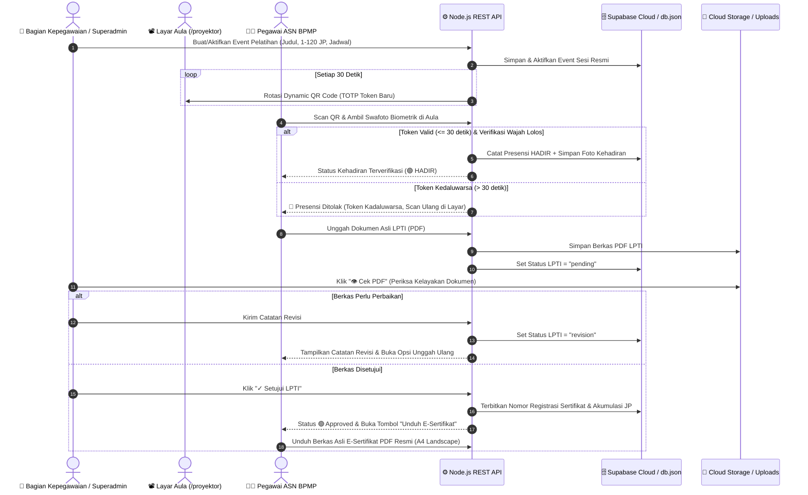

# 🏛️ BPMP SULTRA — SENIN BERSERI
### Sistem Presensi Mandiri, Verifikasi LPTI & Penerbitan E-Sertifikat ASN

<p align="center">
  
  
  
  
  
  
  
</p>

<p align="center">
  <b>Aplikasi Web Full-Stack Terpadu Pengembangan Kompetensi Aparatur Sipil Negara (ASN)</b><br>
  Balai Penjaminan Mutu Pendidikan (BPMP) Provinsi Sulawesi Tenggara — Kementerian Pendidikan, Kebudayaan, Riset, dan Teknologi.<br>
  <i>Dilengkapi Dynamic QR Code 30 Detik (Anti-Titip Presensi), Verifikasi Biometrik Wajah ASN, Kurasi Dokumen PDF LPTI, Multi-Level Role (Superadmin & Kepegawaian), Akumulasi Jam Pelajaran (JP), serta Otomasi Penerbitan E-Sertifikat Resmi A4 Landscape.</i>
</p>

---

## 📑 Daftar Isi
- [✨ Fitur Unggulan](#-fitur-unggulan)
- [🔄 Diagram Alur Kerja Sistem (Mermaid)](#-diagram-alur-kerja-sistem)
- [👥 Hak Akses & Kredensial Pengguna](#-hak-akses--kredensial-pengguna)
- [🛠️ Arsitektur & Spesifikasi Teknologi](#️-arsitektur--spesifikasi-teknologi)
- [🗄️ Skema Database & Migrasi Supabase](#️-skema-database--migrasi-supabase)
- [🚀 Panduan Instalasi Lokal (Quick Start)](#-panduan-instalasi-lokal-quick-start)
- [☁️ Panduan Deploy ke Vercel (Production)](#️-panduan-deploy-ke-vercel-production)
- [📡 Spesifikasi REST API](#-spesifikasi-rest-api)
- [📂 Struktur Direktori Proyek](#-struktur-direktori-proyek)
- [🖨️ Tata Naskah & Spesifikasi E-Sertifikat](#️-tata-naskah--spesifikasi-e-sertifikat)

---

## ✨ Fitur Unggulan

### 1. 🛡️ Presensi Aula Anti-Titip Ganda (*Dual-Layer Verification*)
* **Dynamic QR Code Rotasi 30 Detik**: Server mengacak kode presensi (*Time-based One-Time Token*) setiap 30 detik secara tersinkronisasi. Foto QR yang dikirimkan via chat/WhatsApp akan otomatis kedaluwarsa sebelum sempat dipindai rekan di luar aula.
* **Verifikasi Biometrik Wajah ASN (*Face Biometrics*)**: Saat pegawai memindai presensi di aula, portal dapat meminta pengambilan swafoto (*selfie camera*) untuk mencocokkan wajah pegawai dengan data biometrik master yang terdaftar.
* **Layar Proyektor Aula Fullscreen (`/proyektor`)**: Antarmuka khusus panitia aula yang menyajikan QR resolusi tinggi, cincin hitung mundur (*countdown ring*), audio cue lonceng pergantian QR, serta counter jumlah peserta hadir secara langsung.

### 2. 👑 Manajemen Multi-Peran (RBAC)
* **Super Administrator (`superadmin`)**:
  * Kendali menyeluruh konfigurasi sistem, database, dan seluruh kegiatan pelatihan.
  * Otoritas eksklusif untuk menjalankan fitur *Reset Data Pengujian* (`/api/reset-data`).
  * Badge visual: **👑 SUPERADMIN** pada dashboard.
* **Bagian Kepegawaian (`admin` / `kepegawaian`)**:
  * Penanggung jawab operasional kepegawaian harian.
  * Pembuatan & aktivasi event pelatihan (1–120 JP).
  * Pengawasan presensi aula & peninjauan dokumen LPTI.
  * Penerbitan e-sertifikat resmi & pendaftaran/reset data biometrik wajah ASN.
  * Badge visual: **👔 KEPEGAWAIAN** pada dashboard.
* **Pegawai ASN BPMP Sultra**:
  * Pangkalan data resmi **104 Pegawai ASN** (Pimpinan, Kasubbag Umum, Widyaprada, Analis, Staf Pelaksana).
  * Login mudah menggunakan NIP 18 digit.
  * Presensi instan di aula, unggah laporan PDF LPTI, serta klaim & unduh e-sertifikat ber-JP.

### 3. 📄 Kurasi Laporan Pasca Pelatihan (LPTI) Terintegrasi
* **Penyimpanan Berkas Nyata**: Unggah berkas asli format `application/pdf` (maksimal 15MB) yang tersimpan rapi di Supabase Storage / sistem file lokal.
* **Alur Persetujuan 4 Tahap (*Approval Lifecycle*)**:
  * ⚪ **None**: Pegawai belum mengunggah laporan pasca kegiatan.
  * 🟡 **Pending (*Pulse Animation*)**: Berkas telah diunggah dan sedang dalam antrean verifikasi Bagian Kepegawaian.
  * 🔴 **Revision**: Berkas memerlukan perbaikan (dilengkapi catatan/alasan penolakan dari admin).
  * 🟢 **Approved**: Berkas dinyatakan sah, jam pelajaran (JP) terkumpul, dan e-sertifikat resmi langsung diterbitkan.
* **Fitur Pratinjau Cepat**: Admin dapat langsung mengklik tombol **"👁️ Cek PDF"** untuk memeriksa isi dokumen LPTI pegawai di tab baru peramban.

### 4. 🎓 Otomasi Penerbitan E-Sertifikat Resmi (PDF-Lib Engine)
* **Dukungan Template Fleksibel**: Admin dapat mengunggah template piagam kustom dalam bentuk **Foto (`.png`, `.jpg`)** atau dokumen **PDF (`.pdf`)**, maupun menggunakan template piagam resmi standar BPMP Sultra.
* **Injeksi Teks Presisi**: Sistem menempatkan Nomor Register Surat Resmi dan Nama Lengkap Pegawai (dengan garis bawah dan tipografi proporsional) secara otomatis menggunakan mesin vektor `pdf-lib`.
* **Pengaturan Tata Letak & Live Preview**: Admin dapat mengatur posisi vertikal teks nama (*Y-axis ratio*), ukuran huruf (*font size*), format nomor naskah, serta menguji hasilnya secara instan via tombol **"🧪 Uji Preview Sampel PDF"**.
* **Verifikasi Publik Digital**: Setiap e-sertifikat memuat tautan & QR Code verifikasi publik pada endpoint `/api/verify-cert/:certNumber` untuk membuktikan keaslian dokumen di mata pihak eksternal.

### 5. 💾 Arsitektur Hybrid Cloud & Failover Otomatis
* Menggunakan **Supabase Cloud PostgreSQL** sebagai basis data cloud production berkecepatan tinggi dan Supabase Storage untuk media berkas.
* Dilengkapi mesin **In-Memory & `db.json` Cache Fallback**: Jika koneksi cloud atau kunci API belum dikonfigurasi, sistem tetap dapat berjalan 100% lancar secara lokal (*zero configuration required*).

### 6. 📱 Progressive Web App (PWA)
* Aplikasi dapat diinstal langsung di layar utama smartphone Android, iPhone/iPad, maupun desktop (*Add to Home Screen*) dengan icon resmi Tut Wuri Handayani / Kemendikbudristek.

---

## 🔄 Diagram Alur Kerja Sistem



---

## 👥 Hak Akses & Kredensial Pengguna

### 1. Kredensial Administrator
| Peran (Role) | Username | Sandi Default | Hak Akses & Fitur |
| :--- | :--- | :--- | :--- |
| **👑 Super Administrator** | `superadmin` | `Bpmp2026!` | Kontrol penuh sistem, manajemen event, kurasi LPTI, biometrik, konfigurasi piagam, serta wewenang khusus **Reset Data Pengujian** (`/api/reset-data`). |
| **👔 Bagian Kepegawaian** | `admin`<br>*(alias: `kepegawaian`)* | `Bpmp2026!` | Manajemen event pelatihan, kontrol layar QR aula, verifikasi LPTI, terbitkan e-sertifikat, dan registrasi/reset biometrik wajah pegawai. |

> [!NOTE]
> Kata sandi administrator dapat diubah melalui variabel lingkungan (*environment variable*) `SUPERADMIN_PASSWORD` dan `ADMIN_PASSWORD`.

### 2. Akun Pegawai ASN BPMP Sultra (Total: 104 Pegawai Terdaftar)
* **Format Username**: NIP Pegawai (18 Digit Angka).
* **Kata Sandi Default**: **`Bpmp2026!`** (berlaku untuk seluruh pegawai).

#### Sampel Akun untuk Pengujian Cepat:
| Nama Pegawai | NIP | Jabatan | Status Awal Pengujian |
| :--- | :--- | :--- | :---: |
| **Junaiddin Pagala, ST, M.T.** | `197606122002121004` | Kepala BPMP Provinsi Sulawesi Tenggara | Disetujui (Sertifikat Terbit) |
| **Rika Ernita Mekuo, S.Si. M.Si.** | `198106022006042001` | Kepala Subbagian Umum BPMP Sultra | Menunggu Persetujuan LPTI |
| **Riya Ld. Makruf Tonda, S.Pd, M.Pd.** | `196912311995121016` | Widyaprada Ahli Madya | Memerlukan Revisi LPTI |
| **La Siara, S.Pd, M.Pd.** | `197112311997021007` | Ketua Tim Kerja Kemitraan SD | Belum Hadir (Siap Scan QR) |
| **Dra. Tenri Sanna, M.Pd.** | `196611171991012001` | Widyaprada Ahli Madya | Belum Hadir (Siap Scan QR) |

---

## 🛠️ Arsitektur & Spesifikasi Teknologi

| Komponen | Teknologi | Keterangan |
| :--- | :--- | :--- |
| **Runtime Environment** | Node.js (v18.0.0 atau lebih baru) | Lingkungan eksekusi backend JavaScript |
| **Web Server & Routing** | Express.js (v4.19) | Penanganan endpoint RESTful, static assets, & middleware keamanan |
| **Cloud Database** | Supabase (PostgreSQL 15+) | Pangkalan data relasional cloud terkelola |
| **Cloud File Storage** | Supabase Storage (`lpti`, `templates`, `faces`) | Penyimpanan berkas PDF, foto template, dan snapshot presensi |
| **Fallback Database** | Local In-Memory & `db.json` | Sistem failover otomatis jika koneksi internet/cloud terputus |
| **Session & Auth Token** | Stateless HMAC-SHA256 Token & Cookie | Otentikasi aman tanpa sesi stateful (ramah serverless Vercel) |
| **PDF Generation Engine**| `pdf-lib` (v1.17) | Overlay vektor teks nama, nomor surat dinas, & QR verifikasi digital |
| **Dynamic QR Engine** | `qrcode` (Node) + TOTP Algorithm | Rotasi token acak 30 detik + rendering Base64 Data URL |
| **Frontend Framework** | HTML5, Tailwind CSS, Vanilla JavaScript | Antarmuka responsif mobile & desktop bertema resmi Azia / Kemendikbud |
| **Mobile PWA** | Web App Manifest & Service Worker | Akses instan layar penuh seperti aplikasi native |

---

## 🗄️ Skema Database & Migrasi Supabase

Proyek ini telah menyediakan skrip migrasi SQL siap pakai yang dapat langsung dijalankan pada menu **SQL Editor** di dashboard Supabase Anda:

1. [supabase_schema.sql](file:///c:/Users/Lenovo/Documents/senin_berseri/supabase_schema.sql): Skema lengkap seluruh tabel (`admins`, `events`, `employees`, `attendance_logs`), indeks, fungsi trigger pembaruan, dan pengaturan perizinan (*Row Level Security*).
2. [supabase_admin_roles.sql](file:///c:/Users/Lenovo/Documents/senin_berseri/supabase_admin_roles.sql): Migrasi pembagian tingkatan peran Super Administrator (`superadmin`) dan Bagian Kepegawaian (`admin`).
3. [supabase_face_verification.sql](file:///c:/Users/Lenovo/Documents/senin_berseri/supabase_face_verification.sql): Penambahan kolom foto biometrik wajah ASN dan deskriptor kecocokan wajah.

---

## 🚀 Panduan Instalasi Lokal (Quick Start)

### 1. Kloning Repositori & Instal Dependensi
```bash
# Kloning repositori
git clone https://github.com/sahrulraiya23/bpmp-senin-berseri.git
cd bpmp-senin-berseri

# Pasang dependensi Node.js
npm install
```

### 2. Konfigurasi Variabel Lingkungan (Opsional)
Salin berkas `.env.example` menjadi `.env` jika ingin menghubungkan ke Supabase Cloud:
```bash
cp .env.example .env
```
Isi konfigurasi pada berkas `.env`:
```env
SUPABASE_URL=https://your-project-id.supabase.co
SUPABASE_KEY=your-supabase-service-role-key
PORT=3000
ADMIN_PASSWORD=Bpmp2026!
SUPERADMIN_PASSWORD=Bpmp2026!
SESSION_SECRET=kunci-rahasia-kepegawaian-bpmp-2026
```
*(Jika `.env` tidak diisi, sistem otomatis berjalan dalam mode In-Memory & `db.json` lokal).*

### 3. Menjalankan Aplikasi
```bash
npm start
# atau
node server.js
```

### 4. Mengakses Aplikasi di Peramban
* 🏠 **Portal Login Pegawai ASN**: [http://localhost:3000/](http://localhost:3000/)
* 👔 **Login Administrator**: [http://localhost:3000/admin/login](http://localhost:3000/admin/login)
* 📊 **Dashboard Manajemen Kepegawaian**: [http://localhost:3000/admin](http://localhost:3000/admin)
* 📽️ **Layar Proyektor Dynamic QR Aula**: [http://localhost:3000/proyektor](http://localhost:3000/proyektor) *(atau `/qr`)*

---

## ☁️ Panduan Deploy ke Vercel (Production)

Aplikasi ini telah dirancang dengan arsitektur **Vercel Serverless Function** (`vercel.json` dan adaptasi sistem file `/tmp`).

### Langkah-langkah Deploy:
1. Hubungkan repository GitHub Anda ke [Vercel](https://vercel.com).
2. Masukkan variabel lingkungan (*Environment Variables*) di menu **Settings -> Environment Variables** pada Vercel:
   * `SUPABASE_URL`: URL API Supabase Anda.
   * `SUPABASE_KEY`: Kunci *service_role* Supabase.
   * `SESSION_SECRET`: Kunci acak enkripsi token sesi admin.
   * `ADMIN_PASSWORD`: Kata sandi Bagian Kepegawaian (opsional, default: `Bpmp2026!`).
   * `SUPERADMIN_PASSWORD`: Kata sandi Superadmin (opsional, default: `Bpmp2026!`).
3. Klik **Deploy**. Vercel akan otomatis menyajikan aplikasi dengan sertifikat SSL/HTTPS gratis.

---

## 📡 Spesifikasi REST API

### 1. Otentikasi & Sesi
| Metode | Endpoint | Deskripsi |
| :--- | :--- | :--- |
| `POST` | `/api/auth/login` | Login pegawai menggunakan NIP (18 digit) dan password |
| `POST` | `/api/auth/admin-login` | Login admin (mendukung `superadmin`, `admin`, atau alias `kepegawaian`) |
| `GET` | `/api/auth/admin-check` | Memvalidasi keabsahan token sesi admin yang sedang aktif |

### 2. Manajemen Event Pelatihan
| Metode | Endpoint | Deskripsi |
| :--- | :--- | :--- |
| `GET` | `/api/events` | Mengambil seluruh daftar kegiatan & event yang sedang aktif di aula |
| `GET` | `/api/event` | Mengambil rincian informasi satu event pelatihan |
| `POST` | `/api/event` | Menyimpan atau memperbarui data event (Judul, Jadwal, 1–120 JP) |
| `POST` | `/api/events/:id/activate` | Mengaktifkan event terpilih sebagai sesi resmi di layar aula & QR |

### 3. Presensi & Dynamic QR Code
| Metode | Endpoint | Deskripsi |
| :--- | :--- | :--- |
| `GET` | `/api/qr/current` | Mendapatkan token 30 detik aktif, sisa waktu hitung mundur, & Data URL gambar QR |
| `POST` | `/api/presensi/verify-token` | Memvalidasi token QR, mencocokkan verifikasi wajah, & menandai status HADIR |

### 4. Biometrik Wajah ASN
| Metode | Endpoint | Deskripsi |
| :--- | :--- | :--- |
| `POST` | `/api/employees/:id/register-face` | Menyimpan foto master wajah & deskriptor biometrik pegawai |
| `POST` | `/api/employees/:id/reset-face` | Mereset data biometrik wajah pegawai (dilakukan oleh admin) |

### 5. Manajemen Pegawai & Kurasi LPTI
| Metode | Endpoint | Deskripsi |
| :--- | :--- | :--- |
| `GET` | `/api/employees` | Mengambil daftar 104 pegawai, status hadir, berkas LPTI, & JP akumulasi |
| `GET` | `/api/employees/:id` | Mengambil data rincian satu pegawai berdasarkan ID atau NIP |
| `POST` | `/api/employees/:id/upload-lpti` | Mengunggah dokumen PDF asli laporan LPTI via Multer |
| `POST` | `/api/employees/:id/verify-lpti` | Keputusan admin menyetujui (`approve`) atau meminta revisi (`revise`) |

### 6. Desain Template & E-Sertifikat
| Metode | Endpoint | Deskripsi |
| :--- | :--- | :--- |
| `POST` | `/api/event/upload-template` | Mengunggah template kustom piagam baru (Foto PNG/JPG atau PDF) |
| `DELETE` | `/api/event/template` | Menghapus template kustom dan kembali ke piagam resmi standar BPMP |
| `POST` | `/api/event/cert-settings` | Mengatur format nomor naskah, letak vertikal teks nama, dan ukuran font |
| `GET` | `/api/event/sample-certificate.pdf` | Streaming uji coba pratinjau PDF sampel piagam untuk admin |
| `GET` | `/api/employees/:id/certificate.pdf` | Mengunduh berkas resmi PDF e-sertifikat beresolusi tinggi milik pegawai |
| `GET` | `/api/verify-cert/:certNumber` | Laman verifikasi publik keabsahan nomor sertifikat dinas |

### 7. Pemeliharaan Sistem
| Metode | Endpoint | Hak Akses | Deskripsi |
| :--- | :--- | :---: | :--- |
| `POST` | `/api/reset-data` | 👑 **Superadmin** | Membersihkan data presensi uji coba & mengembalikan ke kondisi awal (pegawai asli tetap aman) |

---

## 📂 Struktur Direktori Proyek

```text
senin_berseri/
├── certificate-generator.js         # Mesin overlay PDF-Lib (penempatan teks nama & nomor naskah dinas)
├── db.json                          # Pangkalan data lokal JSON (104 Pegawai ASN & event)
├── package.json                     # Konfigurasi dependensi Node.js & pustaka pihak ketiga
├── server.js                        # Server utama Express.js, REST API, router, & TOTP QR engine
├── supabase-adapter.js              # Adaptor penghubung Supabase Cloud PostgreSQL & in-memory cache
├── supabase_schema.sql              # Skrip SQL inisialisasi tabel, indeks, & kebijakan Supabase
├── supabase_admin_roles.sql         # Skrip SQL pemisahan peran Superadmin & Kepegawaian
├── supabase_face_verification.sql   # Skrip SQL struktur data biometrik wajah ASN
├── vercel.json                      # Konfigurasi deployment serverless Vercel
├── public/                          # Berkas statis antarmuka pengguna
│   ├── admin-login.html             # Halaman masuk khusus Administrator (Superadmin / Kepegawaian)
│   ├── admin.html                   # Dashboard terpadu manajemen kepegawaian & sertifikat
│   ├── index.html                   # Halaman portal utama & login mandiri pegawai ASN
│   ├── pegawai.html                 # Antarmuka presensi, unggah LPTI, & klaim e-sertifikat
│   ├── proyektor.html               # Tampilan proyektor aula layar penuh (Dynamic QR rotasi 30s)
│   ├── manifest.json                # Konfigurasi instalasi Progressive Web App (PWA)
│   └── service-worker.js            # Service worker untuk fungsionalitas caching & PWA
└── uploads/                         # Direktori berkas unggahan lokal
    ├── faces/                       # Direktori foto snapshot presensi & biometrik wajah
    ├── lpti/                        # Direktori berkas dokumen PDF LPTI pegawai
    └── templates/                   # Direktori template piagam sertifikat (Foto/PDF)
```

---

## 🖨️ Tata Naskah & Spesifikasi E-Sertifikat

E-Sertifikat dirancang sesuai kaidah **Tata Naskah Dinas Kementerian Pendidikan, Kebudayaan, Riset, dan Teknologi**:
* **Ukuran Format Kertas**: Standar ISO A4 Landscape ($297 \times 210\text{ mm}$).
* **Komposisi Dokumen**:
  * Lambang Garuda Pancasila / Logo Resmi Kementerian.
  * Ornamen bingkai ganda elegan bernuansa Biru Dongker Resmi (*Navy*) & Aksen Emas (*Gold*).
  * Nomor Register Surat Resmi Kementerian (contoh: `800.1.3/SERT-LPTI/2026/001`).
  * Identitas Lengkap Peserta: Nama Lengkap, Gelar, NIP, Jabatan, dan Instansi Kerja.
  * Judul Kegiatan Pelatihan Resmi & Akumulasi Bobot Jam Pelajaran (JP).
  * Tanda Tangan Elektronik & Stempel Resmi Kepala Balai Penjaminan Mutu Pendidikan Sultra.
  * Dynamic QR Code Verifikasi Keabsahan Dokumen Digital (dapat diverifikasi langsung oleh inspektorat / BKN / publik).

---

<p align="center">
  <b>Balai Penjaminan Mutu Pendidikan (BPMP) Provinsi Sulawesi Tenggara</b><br>
  Kementerian Pendidikan, Kebudayaan, Riset, dan Teknologi &bull; Republik Indonesia &copy; 2026
</p>
