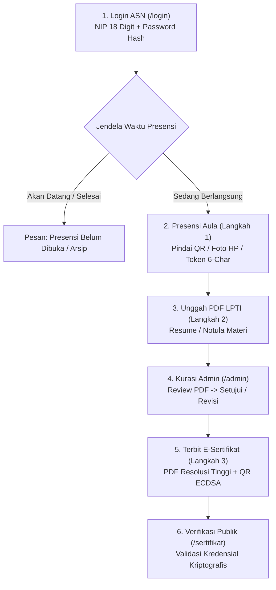

# 🏛️ BPMP SULTRA — SENIN BERSERI
### Sistem Presensi Mandiri, Verifikasi LPTI & Penerbitan E-Sertifikat ASN

<p align="center">
  
</p>

<p align="center">
  
  
  
  
  
  
</p>

<p align="center">
  <b>Aplikasi Web Terpadu Pengembangan Kompetensi Aparatur Sipil Negara (ASN)</b><br>
  Balai Penjaminan Mutu Pendidikan (BPMP) Provinsi Sulawesi Tenggara<br>
  <b>Kementerian Pendidikan Dasar dan Menengah Republik Indonesia</b>
</p>

<p align="center">
  🌐 <b>Production URL:</b> <a href="https://bpmp-senin-berseri.vercel.app"><b>https://bpmp-senin-berseri.vercel.app</b></a>
</p>

---

## 📋 Daftar Isi
1. [Ringkasan Sistem](#-ringkasan-sistem)
2. [Pembaruan Fitur Terbaru](#-pembaruan-fitur-terbaru-versi-stabil)
3. [Akun Pengujian (Testing Credentials)](#-akun-pengujian-testing-credentials)
4. [Alur Skenario Penggunaan](#-alur-skenario-penggunaan)
5. [Fitur-Fitur Unggulan](#-fitur-fitur-unggulan-sistem)
6. [Peta Navigasi Halaman Web](#-peta-navigasi-halaman-web)
7. [Arsitektur & Keamanan](#-arsitektur--keamanan)
8. [Panduan Instalasi & Menjalankan Lokal](#-panduan-instalasi--menjalankan-lokal)

---

## 🌟 Ringkasan Sistem

**Senin Berseri** adalah sistem web kepegawaian internal BPMP Provinsi Sulawesi Tenggara yang mendigitalkan seluruh siklus pengembangan kompetensi ASN mingguan:
1. **Presensi Fisik Aula:** Menggunakan Dynamic QR Code berbasis waktu (rotasi 30 detik) dan token numerik untuk mencegah kecurangan titip presensi.
2. **Kurasi Laporan LPTI:** Pengunggahan berkas Laporan Pelaksanaan Tugas Instansi (LPTI) format PDF dengan alur persetujuan (*approval/revision*) oleh Administrator Kepegawaian.
3. **Penerbitan E-Sertifikat Resmi:** E-Sertifikat berbobot Jam Pelajaran (JP) resmi diterbitkan otomatis berformat PDF resolusi tinggi dengan QR Code verifikasi tanda tangan digital ECDSA P-256 ala Dicoding/Google Developers.

---

## 🚀 Pembaruan Fitur Terbaru (Versi Stabil)

### 1. 🔐 Keamanan & Autentikasi Login ASN (`/login`)
* **Login NIP Eksklusif:** Autentikasi menggunakan 18-digit NIP resmi tanpa *autocomplete* publik, mencegah kebocoran data seluruh pegawai bagi pengguna yang belum terotentikasi.
* **Penyimpanan Password Ter-Hash:** Kata sandi disimpan dengan enkripsi satu arah berbasis **PBKDF2 SHA-512 dengan salt acak 16-byte** (`salt:hash`), secara otomatis memperbarui password *legacy*.
* **Wajib Ganti Password Login Pertama:** Pegawai yang masih memakai kata sandi bawaan diwajibkan mengganti kata sandi baru (minimal 6 karakter) melalui modal interaktif sebelum dapat mengakses portal.
* **Rate Limiting Login:** Pengamanan serangan *brute force* (maksimal 5 kali percobaan gagal per NIP/IP → akun dikunci otomatis selama 5 menit).
* **Proteksi Lingkungan Produksi:** Tombol uji coba 1-klik disembunyikan di UI produksi dan ditolak oleh server dengan `403 Forbidden` jika diakses di *live environment*.

### 2. 📱 Portal Mandiri Pegawai ASN (`/pegawai`)
* **Stepper Horizontal 3 Langkah:** Menggantikan kartu bertumpuk dengan alur horizontal yang ringkas. Konten interaktif hanya terbuka untuk langkah yang sedang aktif:
  * *Langkah 1 (Presensi Aula):* Aksi utama tombol besar **Pindai QR Aula**, aksi sekunder foto kamera HP & token 6-karakter.
  * *Langkah 2 (Laporan LPTI):* Terbuka setelah presensi selesai; dilengkapi form unggah PDF dan catatan revisi admin.
  * *Langkah 3 (E-Sertifikat):* Terbit otomatis setelah presensi aula tuntas dan LPTI disetujui.
* **Tiga Tab Navigasi Portal:**
  * **Kegiatan Saat Ini:** Stepper alur pelatihan yang sedang berjalan.
  * **Akan Datang:** Jadwal kegiatan pelatihan mendatang yang dipublikasikan dengan fitur **"Tambah ke Kalender (.ics)"**.
  * **Riwayat Saya:** Catatan pelatihan khusus pegawai yang login, filter tahun, akumulasi capaian Jam Pelajaran (*"X dari 20 JP tahun ini"*), dan tombol **"Unduh Rekap JP (PDF)"**.
* **Validasi Waktu Sisi Server:** Presensi ditolak jika kegiatan berada di luar jendela waktu (status *Akan Datang* atau *Selesai/Arsip*).
* **Indikator Biometrik Wajah:** Menampilkan status master biometrik wajah terdaftar beserta tautan pendaftaran wajah mandiri bagi yang belum terdaftar.

### 3. 📊 Revamp Dashboard Admin Kepegawaian (`/admin`)
* **Tabel Rekap 10 Kolom Rapi & Terpadu:**
  * Kolom: Checkbox, No, Nama (gelar terpisah), NIP, Jabatan/Unit Kerja, Presensi Aula, Biometrik Wajah, Berkas LPTI, E-Sertifikat, dan Aksi Admin.
  * *Table-layout: fixed* dengan *sticky header* solid `#f8fafc` (`z-index: 10`) tanpa tembus pandang dan tanpa *scroll-in-scroll*.
  * Baris padat (~54px) dengan status kosong digantikan em-dash (`—`) redup.
  * Istilah diseragamkan: *"Perlu Dikurasi"* dan *"Belum Diunggah"*.
* **Bulk Actions & Ekspor:**
  * Checkbox per baris & *Pilih Semua* dengan *floating action bar* untuk **Setujui LPTI Terpilih** dan **Terbitkan Sertifikat Terpilih**.
  * Tombol **Ekspor Excel** (CSV UTF-8 BOM yang rapi di Microsoft Excel) dan **Ekspor/Cetak PDF** berkop resmi instansi.
* **KPI Interaktif:** Kartu metrik (Total ASN, Hadir, LPTI Menunggu, Sertifikat Terbit) dilengkapi persentase, *progress bar* tipis, dan dapat diklik untuk memfilter tabel secara instan.
* **Pengaturan Terpisah:** Formulir tambah event dan kustomisasi piagam dipindahkan ke modal Bootstrap (`#eventFormModal` & `#certCustomizerModal`).
* **Proteksi Reset Data:** Tombol reset pengujian hanya tampil di lingkungan dev (`[DEV]`); di produksi dipindahkan ke modal Pengaturan Sistem dengan konfirmasi pengetikan kata `"RESET DATA"`.

---

## 🔑 Akun Pengujian (Testing Credentials)

| Identitas (NIP) | Kata Sandi Bawaan | Nama Pegawai & Jabatan | Hak Akses |
| :--- | :--- | :--- | :--- |
| **`199508232024011001`** | **`Bpmp2026!`** | **Muhammad Saharullah Raiya**<br><sub>Pranata Komputer / Pengembang Sistem</sub> | Portal ASN (`/login`) & Admin (`/admin/login`) |
| **`198705122010011003`** | **`Bpmp2026!`** | **M. Rafli**<br><sub>Pengelola Mutu Kepegawaian ASN</sub> | Portal ASN (`/login`) & Admin (`/admin/login`) |
| **`198902142014022001`** | **`Bpmp2026!`** | **User Pegawai ASN (Testing)**<br><sub>Staf Pelaksana BPMP Sultra</sub> | Portal ASN (`/login`) |
| **`admin`** | **`Bpmp2026!`** | **Bagian Kepegawaian BPMP Sultra** | Dashboard Admin (`/admin/login`) |
| **`superadmin`** | **`Bpmp2026!`** | **Super Administrator BPMP Sultra** | Konsol Superadmin (`/admin/login`) |

> [!NOTE]
> * Pada saat pertama kali login menggunakan kata sandi bawaan di atas, sistem akan menampilkan dialog wajib ganti kata sandi baru demi alasan keamanan.
> * Jika terjadi 5 kali kegagalan login berturut-turut, sistem rate limiter akan mengunci akun selama 5 menit.

---

## 📲 Alur Skenario Penggunaan



---

## ✨ Fitur-Fitur Unggulan Sistem

### 1. 🛡️ Dynamic QR Code 30 Detik Anti-Titip Presensi
* Token presensi aula diacak otomatis setiap 30 detik berbasis waktu (*Time-based One-Time Token*).
* Layar proyektor aula ([`/proyektor`](https://bpmp-senin-berseri.vercel.app/proyektor)) dilengkapi animasi lingkaran hitung mundur (*countdown ring*), denting suara pembaruan QR, dan penghitung kehadiran *real-time*.

### 2. 🔐 Verifikasi Sertifikat Digital ECDSA Kriptografis (Dicoding-Style)
* Piagam penghargaan ditandatangani secara digital dengan kurva eliptis **ECDSA P-256** dan ringkasan pesan **SHA-256**.
* Halaman verifikasi publik ([`/sertifikat`](https://bpmp-senin-berseri.vercel.app/sertifikat)) memungkinkan siapa saja memvalidasi keaslian dokumen tanpa perlu login.

### 3. 📄 Siklus Kurasi LPTI Paperless
* Pegawai mengunggah dokumen PDF notula kegiatan.
* Admin kepegawaian dapat menyetujui secara tunggal atau massal (*bulk approval*), maupun mengembalikan berkas dengan catatan perbaikan instan.

### 4. 📅 Manajemen Kalender & Riwayat JP
* Ekspor jadwal kegiatan mendatang langsung ke aplikasi kalender ponsel / Google Calendar / Outlook via berkas standar `.ics`.
* Akumulasi perolehan Jam Pelajaran (JP) ASN terpantau dinamis terhadap target tahunan instansi (*20 JP per tahun*).
* Cetak rekapitulasi capaian pelatihan ASN berkop resmi instansi.

---

## 🗺️ Peta Navigasi Halaman Web

| Halaman | URL Rute | Keterangan |
| :--- | :--- | :--- |
| **Beranda Portal Resmi** | [`/`](https://bpmp-senin-berseri.vercel.app/) | Profil institusi BPMP Sultra, pusat akses layanan, maklumat, & floating helpdesk. |
| **Portal Mandiri ASN** | [`/login`](https://bpmp-senin-berseri.vercel.app/login) / [`/pegawai`](https://bpmp-senin-berseri.vercel.app/pegawai) | Login aman NIP, stepper 3 langkah presensi, LPTI, sertifikat, event mendatang, & riwayat. |
| **Verifikasi Sertifikat Publik** | [`/sertifikat`](https://bpmp-senin-berseri.vercel.app/sertifikat) | Validasi publik keaslian piagam ber-QR ECDSA P-256 ala Dicoding. |
| **Layar Proyektor Aula** | [`/proyektor`](https://bpmp-senin-berseri.vercel.app/proyektor) | Tampilan layar penuh aula dengan rotasi Dynamic QR TOTP 30 detik. |
| **Pendaftaran Biometrik Wajah** | [`/verif-wajah`](https://bpmp-senin-berseri.vercel.app/verif-wajah) | Registrasi mandiri foto master wajah pegawai ASN. |
| **Login Administrator** | [`/admin/login`](https://bpmp-senin-berseri.vercel.app/admin/login) | Masuk khusus Pengelola Kepegawaian & Super Administrator. |
| **Dashboard Admin Kepegawaian** | [`/admin`](https://bpmp-senin-berseri.vercel.app/admin) | Monitoring presensi, tabel 10-kolom fixed layout, kurasi LPTI, bulk actions, & ekspor data. |
| **Konsol Superadmin** | [`/superadmin`](https://bpmp-senin-berseri.vercel.app/superadmin) | Master data 105 ASN, sinkronisasi Supabase PostgreSQL, & pengaturan sistem. |

---

## 🛠️ Arsitektur & Keamanan

| Lapisan | Komponen | Deskripsi |
| :--- | :--- | :--- |
| **Runtime & Server** | Node.js (v20+) & Express.js | Backend RESTful API & asset pipeline |
| **Frontend UI** | Tabler UI & Bootstrap 5 | Desain responsif resmi Kemendikdasmen, sentuhan mobile ≥44px |
| **Keamanan Password** | PBKDF2 SHA-512 + Salt 16-byte | Enkripsi kata sandi kuat tanpa dependensi eksternal |
| **Keamanan Presensi** | TOTP 30s + Window Enforcement | Validasi status kegiatan & jendela waktu presensi di server |
| **Keamanan Sertifikat** | ECDSA P-256 + SHA-256 | Tanda tangan digital kriptografis resmi Kepala Balai |
| **Basis Data Utama** | Supabase Cloud (PostgreSQL 15+) | Pangkalan data relasional terpusat cloud |
| **Storage Berkas** | Supabase Storage (Bucket: `lpti`, `faces`) | Penyimpanan dokumen PDF LPTI & foto presensi |
| **Pembuatan Dokumen** | `pdf-lib` Vector Engine | Render dinamis sertifikat & lembar rekapitulasi |
| **Cloud Hosting** | Vercel Serverless Platform | Deployment otomatis berbasis Git dengan *zero-cache header* |

---

## 🚀 Panduan Instalasi & Menjalankan Lokal

### 1. Kloning Repositori & Pasang Dependensi
```bash
git clone https://github.com/sahrulraiya23/bpmp-senin-berseri.git
cd bpmp-senin-berseri
npm install
```

### 2. Konfigurasi Lingkungan (`.env`)
Salin berkas `.env.example` menjadi `.env`:
```env
SUPABASE_URL=https://your-project.supabase.co
SUPABASE_KEY=your-supabase-service-role-key
ADMIN_PASSWORD=Bpmp2026!
SUPERADMIN_PASSWORD=Bpmp2026!
TARGET_ANNUAL_JP=20
APP_ENV=development
PORT=3000
```

### 3. Menjalankan Server & Pengujian
```bash
# Menjalankan unit test suite (16 tests)
npm test

# Menjalankan server aplikasi
npm start
# Buka http://localhost:3000 di browser
```

---

<p align="center">
  <b>Balai Penjaminan Mutu Pendidikan (BPMP) Provinsi Sulawesi Tenggara</b><br>
  Kementerian Pendidikan Dasar dan Menengah &bull; Republik Indonesia &copy; 2026
</p>
