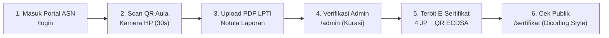

# 🏛️ BPMP SULTRA — SENIN BERSERI
### Sistem Presensi Mandiri, Verifikasi LPTI & Penerbitan E-Sertifikat ASN

<p align="center">
  
</p>

<p align="center">
  
  
  
  
  
  
</p>

<p align="center">
  <b>Aplikasi Web Terpadu Pengembangan Kompetensi Aparatur Sipil Negara (ASN)</b><br>
  Balai Penjaminan Mutu Pendidikan (BPMP) Provinsi Sulawesi Tenggara<br>
  <b>Kementerian Pendidikan Dasar dan Menengah Republik Indonesia</b>
</p>

<p align="center">
  🌐 <b>Production URL:</b> <a href="https://bpmp-senin-berseri.vercel.app"><b>https://bpmp-senin-berseri.vercel.app</b></a>
</p>

---

## 📱 Panduan Pengujian Cepat Menggunakan Smartphone (HP)

Aplikasi telah dioptimalkan secara responsif (*mobile-friendly*) untuk layar ponsel cerdas (Android & iPhone). Anda dapat langsung membuka alamat aplikasi di browser HP dan menguji alur presensi, kurasi berkas, serta verifikasi e-sertifikat.

### 🔑 Akun Pengujian Langsung (Ready to Test):

| ID / Username | Nomor Induk Pegawai (NIP) | Kata Sandi (Password) | Nama Lengkap & Jabatan | Peruntukan Akses |
| :--- | :--- | :--- | :--- | :--- |
| **`sahrul`** | `199508232024011001` | **`bpmp123`** *(atau `Bpmp2026!`)* | **Muhammad Saharullah Raiya**<br><sub>Pranata Komputer / Pengembang Sistem</sub> | Portal ASN (`/login`) & Admin (`/admin/login`) |
| **`rafli`** | `199703142024021002` | **`bpmp123`** *(atau `Bpmp2026!`)* | **M. Rafli**<br><sub>Pengelola Mutu Kepegawaian ASN</sub> | Portal ASN (`/login`) & Admin (`/admin/login`) |
| **`user`** | `199811052024031003` | **`bpmp123`** *(atau `Bpmp2026!`)* | **User Pegawai ASN (Testing)**<br><sub>Staf Pelaksana BPMP Sultra</sub> | Portal ASN (`/login`) & Admin (`/admin/login`) |
| **`admin`** | *(Username Admin)* | **`Bpmp2026!`** | **Admin Bagian Kepegawaian** | Dashboard Admin Kepegawaian (`/admin/login`) |
| **`superadmin`**| *(Username Master)* | **`Bpmp2026!`** | **Super Administrator BPMP Sultra** | Konsol Penuh Superadmin (`/admin/login`) |

> [!TIP]
> **Kemudahan Input di HP**: Pada kolom identifikasi pegawai di halaman login ASN, Anda cukup mengetik nama panggilan (contoh: **`sahrul`**, **`rafli`**, atau **`user`**). Sistem akan otomatis mengenali akun Anda tanpa harus menghafal 18 digit NIP!

---

### 📲 Langkah-Langkah Skenario Uji Coba di HP:



1. **Langkah 1 (Buka Portal Pegawai di HP)**:
   * Buka browser HP: [**`https://bpmp-senin-berseri.vercel.app/login`**](https://bpmp-senin-berseri.vercel.app/login).
   * Ketik **`sahrul`**, **`rafli`**, atau **`user`** pada kolom pencarian identitas, lalu konfirmasi identitas Anda.
   * Masukkan kata sandi: **`bpmp123`** (atau `Bpmp2026!`).
2. **Langkah 2 (Presensi Aula Cerdas)**:
   * Buka layar proyektor aula pada tab/perangkat lain: [**`/proyektor`**](https://bpmp-senin-berseri.vercel.app/proyektor).
   * Klik tombol **"Pindai QR Aula"** di HP Anda, arahkan kamera ponsel ke QR Code aula yang berputar setiap 30 detik.
   * Status kehadiran Anda langsung tercatat resmi sebagai **🟢 HADIR**.
3. **Langkah 3 (Unggah Notula LPTI)**:
   * Pilih berkas laporan format PDF (maks. 15MB) dari galeri/berkas HP Anda, lalu klik **"Unggah Notula LPTI"**.
   * Status akan berubah menjadi **🟡 Pending Kurasi**.
4. **Langkah 4 (Kurasi oleh Kepegawaian)**:
   * Buka konsol admin: [**`/admin/login`**](https://bpmp-senin-berseri.vercel.app/admin/login) (login dengan user `admin` / pass `Bpmp2026!` atau akun `sahrul`).
   * Klik tombol **"✓ Setujui LPTI"**.
5. **Langkah 5 (Klaim E-Sertifikat 4 JP)**:
   * Kembali ke portal pegawai di HP Anda, e-sertifikat resmi langsung terbit otomatis lengkap dengan nomor surat dinas dan bobot 4 Jam Pelajaran (JP).
   * Klik **"Unduh E-Sertifikat (PDF)"** untuk mengunduh piagam asli resolusi tinggi berstempel basah dan bertanda tangan elektronik Kepala Balai.
6. **Langkah 6 (Verifikasi Kriptografis ECDSA Publik)**:
   * Buka halaman verifikasi sertifikat publik: [**`/sertifikat`**](https://bpmp-senin-berseri.vercel.app/sertifikat).
   * Masukkan 12-digit kode kredensial unik (contoh: `6RPNYVJL4Z2M` atau scan QR di pojok kanan bawah sertifikat).
   * Sistem akan memvalidasi tanda tangan digital ECDSA secara matematis dengan visual kredensial resmi ala Dicoding / Google Developers!

---

## ✨ Fitur-Fitur Unggulan Sistem

### 1. 🛡️ Dynamic QR Code 30 Detik Anti-Titip Presensi
* Token presensi diacak secara otomatis setiap 30 detik berbasis waktu (*Time-based One-Time Token*).
* Foto QR yang difoto atau dikirim lewat chat akan kedaluwarsa sebelum sempat dipindai oleh pihak di luar aula.
* Layar aula utama ([`/proyektor`](https://bpmp-senin-berseri.vercel.app/proyektor)) dilengkapi animasi lingkaran hitung mundur (*countdown ring*), denting suara pembaruan QR, dan penghitung kehadiran *real-time*.

### 2. 🔐 Verifikasi Sertifikat Digital ECDSA Kriptografis (Dicoding-Style)
* Dilengkapi tanda tangan digital kriptografi kurva eliptis **ECDSA (secp256k1 / P-256)** dengan ringkasan pesan **SHA-256**.
* QR Code resmi ditempatkan di pojok kanan bawah sertifikat.
* Siapapun (publik, BKN, inspektorat, instansi lain) dapat memindai QR Code atau membuka [**`/sertifikat`**](https://bpmp-senin-berseri.vercel.app/sertifikat) untuk memeriksa status keaslian dokumen, tanggal terbit, verifikator Kepala Balai, serta kode kredensial 12 digit tanpa perlu login.

### 3. 📸 Registrasi & Verifikasi Biometrik Wajah ASN
* Halaman mandiri perekaman foto master wajah: [**`/verif-wajah`**](https://bpmp-senin-berseri.vercel.app/verif-wajah).
* Menyimpan deskriptor master biometrik untuk pencocokan wajah saat presensi mandiri di aula.

### 4. 📄 Kurasi Notula LPTI Paperless (*Approval Lifecycle*)
* Pegawai mengunggah berkas asli PDF notula LPTI pasca-kegiatan.
* Admin kepegawaian dapat melakukan kurasi langsung di browser:
  * 🟢 **Setujui (Approve)**: Sertifikat otomatis terbit & jam pelajaran (JP) terakumulasi.
  * 🔴 **Revisi (Revise)**: Dilengkapi catatan revisi instan ke akun pegawai.

### 5. 🏛️ Standar UI Kemendikdasmen (Tanpa Celah Hitam)
* Mengusung desain resmi portal `bpmpsultra.kemendikdasmen.go.id`:
  * Warna dominan: Biru Kementerian (`#0056b3`) dan Emas Institusi (`#d97706`).
  * Kanvas putih bersih penuh (*full-width canvas*) tanpa celah hitam tepi.
  * Lambang resmi Tut Wuri Handayani resolusi tinggi.
  * Alert institusi bergaris batas (*border-left 4px solid*) yang rapi dan nyaman dibaca.

---

## 🗺️ Peta Navigasi Halaman Web

| Halaman | URL Rute | Keterangan |
| :--- | :--- | :--- |
| **Beranda Portal Resmi** | [`/`](https://bpmp-senin-berseri.vercel.app/) | Profil institusi BPMP Sultra, pusat akses layanan, maklumat, panduan alur, & floating helpdesk. |
| **Portal Mandiri ASN** | [`/login`](https://bpmp-senin-berseri.vercel.app/login) | Alur runut ASN: identifikasi NIP/nama, scan QR aula, unggah LPTI, dan unduh sertifikat. |
| **Verifikasi Sertifikat ECDSA** | [`/sertifikat`](https://bpmp-senin-berseri.vercel.app/sertifikat) | Validasi publik keaslian piagam 4 JP ala Dicoding menggunakan 12-digit ID atau QR code. |
| **Layar Proyektor Aula** | [`/proyektor`](https://bpmp-senin-berseri.vercel.app/proyektor) | Tampilan layar lebar aula dengan rotasi Dynamic QR 30 detik dan audio cue pergantian token. |
| **Registrasi Wajah ASN** | [`/verif-wajah`](https://bpmp-senin-berseri.vercel.app/verif-wajah) | Pendaftaran mandiri master foto wajah biometrik pegawai. |
| **Login Administrator** | [`/admin/login`](https://bpmp-senin-berseri.vercel.app/admin/login) | Masuk khusus Pengelola Kepegawaian & Super Administrator tanpa navbar redundan. |
| **Dashboard Kepegawaian** | [`/admin`](https://bpmp-senin-berseri.vercel.app/admin) | Monitoring presensi, kurasi berkas LPTI, pengelolaan sesi pelatihan, dan template piagam. |
| **Konsol Superadmin** | [`/superadmin`](https://bpmp-senin-berseri.vercel.app/superadmin) | Master kendali 104 data ASN, sinkronisasi Supabase PostgreSQL, manajemen akun admin, & backup. |

---

## 🛠️ Arsitektur & Teknologi

| Lapisan | Komponen | Deskripsi |
| :--- | :--- | :--- |
| **Runtime** | Node.js (v20+) & Express.js | Backend RESTful API & static asset pipeline |
| **Frontend UI** | Tabler UI (Bootstrap 5) | Desain tokens resmi Kemendikdasmen, responsif di HP & Desktop |
| **Kriptografi** | Node.js Crypto Engine | ECDSA P-256 / secp256k1 & SHA-256 Digital Signature |
| **Cloud Database** | Supabase Cloud (PostgreSQL 15+) | Pangkalan data cloud relasional utama |
| **Failover Memory** | In-Memory Engine & `db.json` | Cadangan otomatis offline/lokal jika koneksi cloud terputus |
| **PDF Generation** | `pdf-lib` Vector Engine | Overlay dinamis nomor surat, nama pegawai, tanda tangan, & QR |
| **Hosting Cloud** | Vercel Serverless Platform | Deployment otomatis berbasis Git dengan proteksi anti-cache |

---

## 🚀 Panduan Instalasi Lokal (Quick Start)

### 1. Kloning Repositori & Pasang Dependensi
```bash
git clone https://github.com/sahrulraiya23/bpmp-senin-berseri.git
cd bpmp-senin-berseri
npm install
```

### 2. Konfigurasi Variabel Lingkungan (Opsional)
Salin `.env.example` ke `.env`:
```env
SUPABASE_URL=https://your-project.supabase.co
SUPABASE_KEY=your-supabase-service-role-key
ADMIN_PASSWORD=Bpmp2026!
SUPERADMIN_PASSWORD=Bpmp2026!
PORT=3000
```
*(Jika tidak diisi, sistem otomatis berjalan dengan pangkalan data cadangan `db.json` lokal).*

### 3. Jalankan Server
```bash
npm start
# Server berjalan di http://localhost:3000
```

---

<p align="center">
  <b>Balai Penjaminan Mutu Pendidikan (BPMP) Provinsi Sulawesi Tenggara</b><br>
  Kementerian Pendidikan Dasar dan Menengah &bull; Republik Indonesia &copy; 2026
</p>
